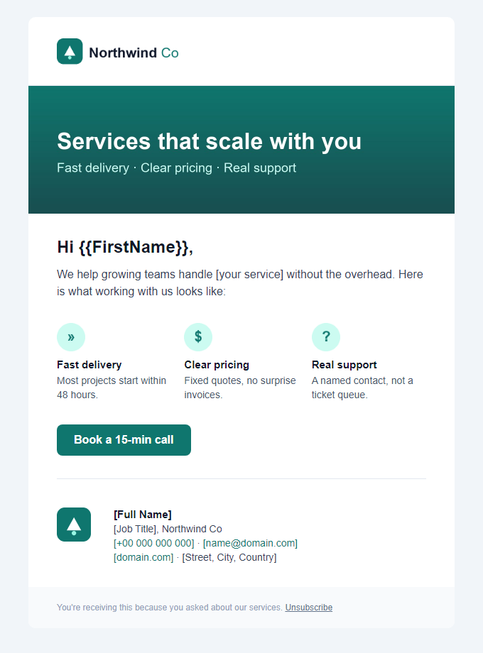
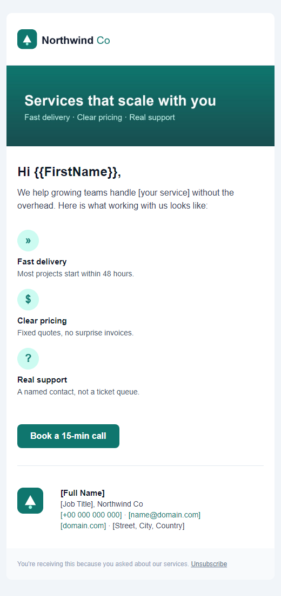
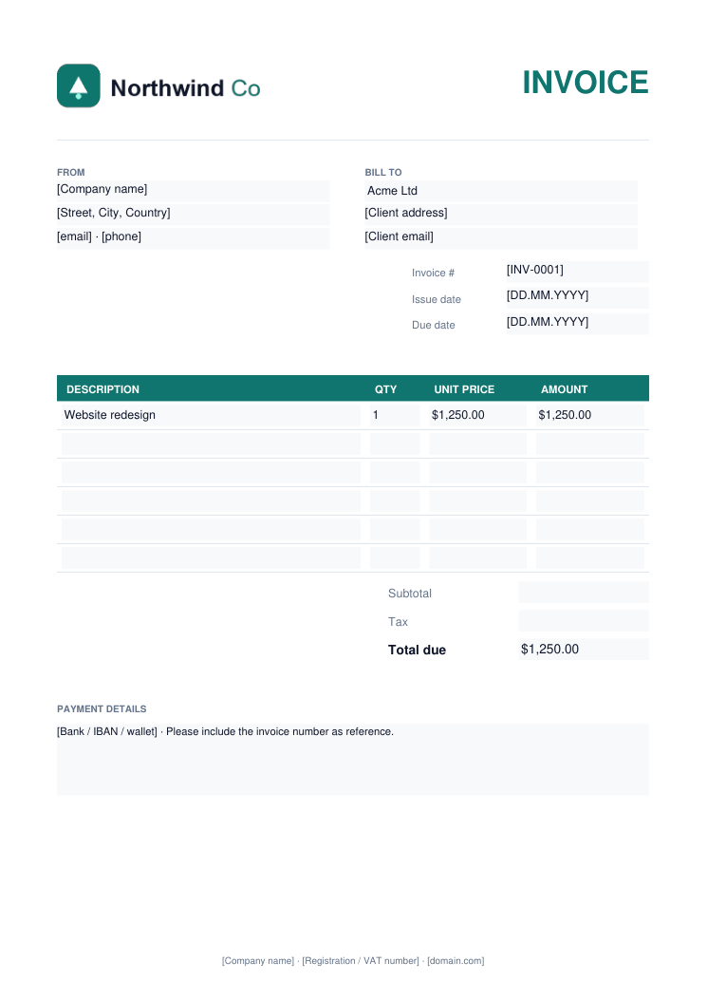
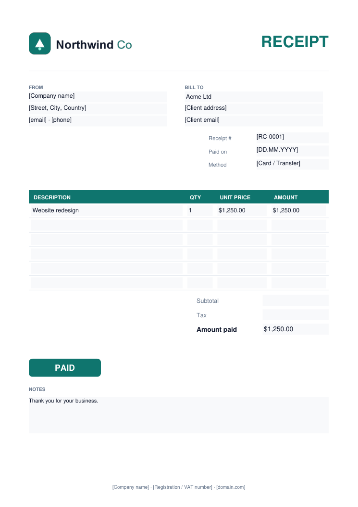

# Email & editable PDF templates

A small branding kit for a fictional company, "Northwind Co": an HTML email that holds up in real
email clients, an email signature, and an invoice and a receipt as **fillable PDF forms**. Every
`[placeholder]` is meant to be replaced; nothing sensitive is hard-coded.

| Email (desktop) | Email (mobile) | Invoice, filled in | Receipt, filled in |
|---|---|---|---|
|  |  |  |  |

## What's inside

| File | What it is |
|---|---|
| `email.html` | 600 px table layout, inline styles, preheader, three-column features that stack on phones, bulletproof button with a VML fallback for Outlook, signature block and unsubscribe footer |
| `signature.html` | Standalone signature to paste into Gmail or Outlook settings |
| `pdf/invoice-editable.pdf` | Fillable invoice: sender, client, number, dates, 6 line items, subtotal/tax/total, payment details - 37 form fields |
| `pdf/receipt-editable.pdf` | Same structure as a receipt with a PAID mark and payment method |
| `assets/logo.svg` | Vector logo (editable source) plus PNG exports for email clients that block SVG |
| `make_pdfs.py` | Regenerates both PDFs - change colours, labels or row count in one place |

## Email client notes

- Layout is nested tables with inline CSS, the format Outlook, Gmail and Apple Mail all render.
- Images have explicit width/height and alt text, so the email still reads with images off.
- The button is a real link everywhere; Outlook desktop gets a VML rounded rectangle.
- Merge tags (`{{FirstName}}`, `{{UnsubscribeURL}}`) follow the common Mailchimp/Brevo style; rename them to
  your platform's syntax.
- Before sending, host `assets/` on your domain and switch the `src` attributes to absolute URLs.

## Editing the PDFs

Open in any PDF reader (Acrobat, Edge, Chrome, Preview) and type into the fields, then save. To change the
design itself:

```bash
pip install reportlab
python make_pdfs.py
```
